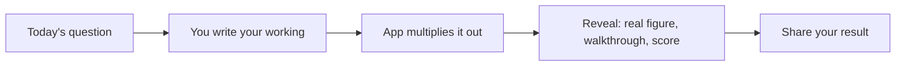

<div align="center">

# 🧻 Napkin

**Show your working. Get roasted.**

A daily estimation game. One question a day, one scribble pad, and a coach who's very honest about your maths.


**[Play today's question](https://napkinmath.co.uk)**

<!-- Add a screenshot of the pad and one of the reveal here -->

</div>

---

## The idea

Every day there's one question, like *"How many pints are pulled in UK pubs on a Friday?"*

You don't guess a number. You **build a napkin**: a few lines of your own assumptions that multiply out to an estimate. Then the reveal lands.

```
Question: how many pints are pulled in UK pubs on a Friday?

  pubs in the UK              45k
  pints per pub, per night    ...your guess
  ──────────────────────────────────────────
  = your estimate             ...and the real figure, with a verdict
```

*(That's the shape of a napkin, not the answer.)*

## What happens next



You get the real number, a narrated route through the problem, a 0 to 100 score and a pub-style verdict. It also shows where your napkin and the model's diverged, which is the useful bit.

## Ways to play

| Mode | What it is |
|---|---|
| **Daily** | One shared question a day, so everyone can compare. |
| **Practice** | Past questions, any time. |
| **Interview** | A laddered run with no help. |
| **Challenge a friend** | Send a link to the same question. |
| **Stats** | Your streak and history. |

## It reads how you write

`1 in 4`, `25%`, `5k` and `2.5M` all work. `per`, `over`, `/` and `÷` divide. A ribbon shows every number it found, so you can see how it read you.

## Why I built it

Estimating from first principles is a core product skill and a common interview question, but the practice tools are dry. Wordle-style games are fun but have no working-out step. Napkin puts the working at the centre and makes it funny.

## Product principles

1. **Showing your working is the game.** There's no bare "type a number" shortcut.
2. **Feel beats features.** It should feel like writing, not a worksheet.
3. **Humour carries the learning.** Credit when you're close, mickey-taking when you're miles off.
4. **A shared daily ritual comes first.**
5. **Casual play stays free.** Paid value is for people serious about practice.

## Built with

Static HTML, CSS and JavaScript with no build step, hosted on GitHub Pages. History lives in your browser first, with a quiet cloud backup. No accounts.

## Where it's at

68 questions in the bank. No usage data yet, and the paid Practice unlock is still undecided.

## More

[PRODUCT.md](PRODUCT.md) covers audience, positioning and brand. [DESIGN.md](DESIGN.md) and [plan.md](plan.md) have the design history.
